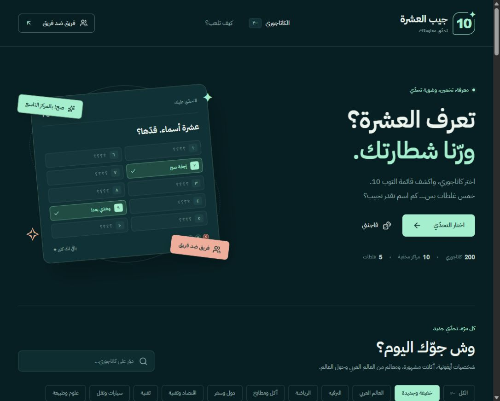

# جيب العشرة

[العب الآن على GitHub Pages](https://mdaar21.github.io/jeeb-ten/)



لعبة عربية تضم 200 كاتاجوري و2000 إجابة. منها 100 تحدٍّ خفيف عن شخصيات وألعاب وأكلات وأشياء أيقونية مشهورة، تشمل 35 كاتاجوري من العالم العربي، إضافة إلى 100 قائمة مبنية على مصادر منشورة.

- **الفردي:** الإجابة الصحيحة تكشف مركزها، دون نقاط. الخطأ الخامس ينهي الجولة ويُظهر الإجابات الفائتة بشفافية وعلامة ×.
- **فريق ضد فريق:** على نفس الجهاز. سمّوا الفريقين وأضيفوا لاعبيهما، ويتناوب الفريقان واللاعبون على قائمة واحدة. قيمة الإجابة رقم مركزها؛ التاسع 9 والأول 1. النتيجة تظهر في النهاية، والخطأ الخامس يخسّر الفريق.
- الأسماء القريبة تُعرض للتأكيد، والأجزاء تحتاج توضيحًا. التكرار والتوضيح لا يخصمان محاولة ولا ينقلان الدور.
- تُحفظ الجولة والفرق محليًا في المتصفح على نفس الجهاز. لا يحتاج اللعب إلى حساب أو خادم أو خدمات ChatGPT.

## التشغيل والنشر

استخدم Node.js 22.13 أو أحدث:

```sh
npm ci
npm run dev
npm test
npm run typecheck
npm run build
```

ينتج البناء مجلد `docs/` الجاهز لـ GitHub Pages. إعداد المستودع: Settings → Pages → Deploy from a branch → `main` → `/docs`.

عند تعديل المصدر، نفّذ البناء ثم ارفع المصدر و`docs/` معًا. يُستخدم المسار `/jeeb-ten/` للملفات والأصول.

## القوائم والمراجع

القوائم الإحصائية مؤرخة ولها مصادر ومعايير واضحة. ترتيب الكاتاجوري الخفيفة الجديدة خاص بالتحدّي؛ مراجعها تتحقق من الأسماء وانتمائها إلى الموضوع، ولا تمثل ترتيبًا إحصائيًا عالميًا أو تصويتًا موثقًا.

ملفات `data/lists-*.json` تحتوي المحتوى، وملفات `data/research-*.md` توثق المراجع والمنهجية. لكل قائمة عشرة مراكز وأسماء عربية وإنجليزية وبدائل معروفة.

بيانات ويكيبيديا المشتقة تخضع لترخيص CC BY-SA حيث ينطبق، مع روابط المقالات الأصلية. الأسماء تستخدم كحقائق تعريفية. خط IBM Plex Sans Arabic مستضاف ذاتيًا مع ترخيص SIL Open Font License داخل `public/fonts/`.
